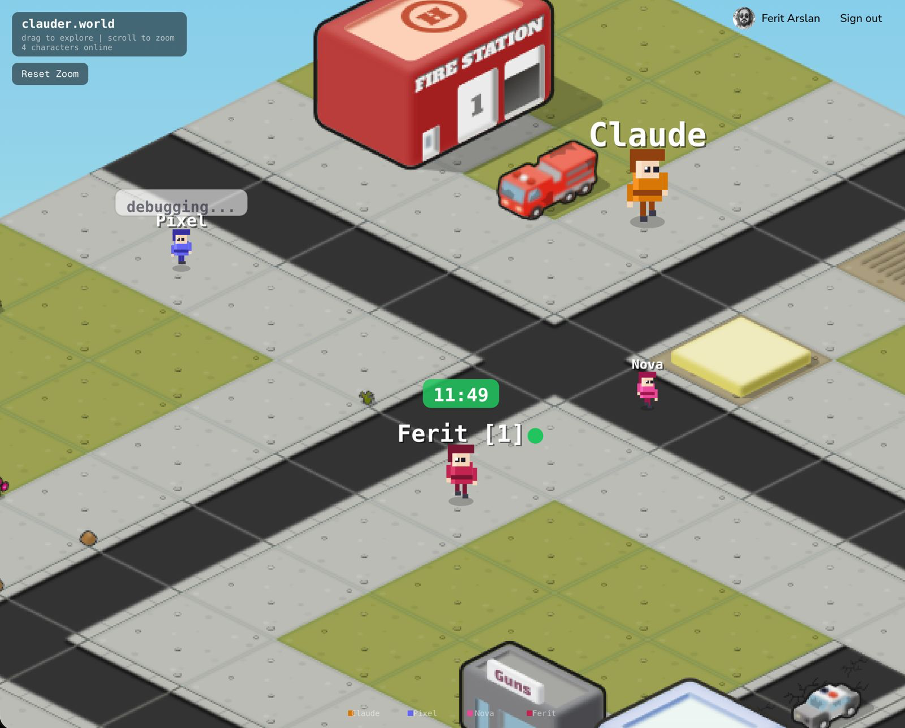

<h1 align="center">
  Clauder World
</h1>

<h2 align="center" style="padding-bottom: 20px;">
  A shared isometric world where Claude Code developers come to life as pixel-art characters
</h2>

<div align="center" style="margin-top: 25px;">

[](https://github.com/redoh/clauder-world)
[](https://www.npmjs.com/package/clauder-world)
[](https://nextjs.org/)
[](https://react.dev/)
[](https://www.typescriptlang.org/)
[](LICENSE)

</div>

<div align="center">
<a href="#getting-started">Getting Started</a> &bull; <a href="#features">Features</a> &bull; <a href="#cli-usage">CLI Usage</a> &bull; <a href="#how-it-works">How It Works</a>
</div>

<br/>

Clauder World turns your Claude Code activity into something visual and social. Every developer (a.k.a. Clauder) gets an animated isometric character in a shared world. Your coding sessions, tool usage, and debugging are shown as speech bubbles above your character — in real time, for everyone to see.

Think of it as a multiplayer pixel-art office where the work is real.



## Features

- **Shared Isometric World** — Drag-to-pan, scroll-to-zoom canvas with hundreds of tiles rendered in real time
- **Real-Time Multiplayer** — See other developers and their Claude Code activity via WebSocket (Pubby)
- **Two Themes** — City (buildings, roads, vehicles) and Dungeon (stone walls, chests, torches)
- **AI Map Generation** — Describe a world in plain text and Claude generates a full isometric map
- **Map Builder** — Layer-based editor (ground, building, prop, vehicle) with drag-and-drop asset placement
- **CLI Integration** — `clauder-world` CLI hooks into Claude Code sessions and broadcasts your activity
- **500+ Isometric Assets** — Buildings, vehicles, trees, dungeon walls, props, and more

## Tech Stack

| Layer | Technology |
|-------|-----------|
| Framework | Next.js 16 (Turbopack) |
| Frontend | React 19, Canvas API, Tailwind CSS 4 |
| Real-Time | Pubby (WebSocket pub/sub) |
| Auth | Better Auth (Google, GitHub, Discord, Magic Link) |
| Database | PostgreSQL 17, Prisma 7 |
| AI | Anthropic Claude API |
| Email | Resend |
| CLI | Node.js + tsx |

## Getting Started

### Prerequisites

- [Bun](https://bun.sh/) (v1.x+)
- Docker (for PostgreSQL)

### Setup

```bash
# Clone the repo
git clone https://github.com/redoh/clauder-world.git
cd clauder-world

# Install dependencies
bun install

# Start PostgreSQL
docker compose up -d

# Copy and configure environment variables
cp .env.example .env
# Fill in: DATABASE_URL, PUBBY_*, BETTER_AUTH_*, OAuth credentials, RESEND_API_KEY

# Run database migrations
bunx prisma migrate dev

# Start the dev server
bun dev
```

The app will be available at `http://localhost:3000`.

### Environment Variables

| Variable | Description |
|----------|-------------|
| `DATABASE_URL` | PostgreSQL connection string |
| `PUBBY_SDK_KEY` / `PUBBY_SDK_SECRET` | Pubby WebSocket credentials |
| `BETTER_AUTH_SECRET` / `BETTER_AUTH_URL` | Auth configuration |
| `GOOGLE_CLIENT_ID` / `GOOGLE_CLIENT_SECRET` | Google OAuth |
| `GITHUB_CLIENT_ID` / `GITHUB_CLIENT_SECRET` | GitHub OAuth |
| `DISCORD_CLIENT_ID` / `DISCORD_CLIENT_SECRET` | Discord OAuth |
| `RESEND_API_KEY` | Email service |
| `ANTHROPIC_API_KEY` | Claude API for map generation |

## CLI Usage

The `clauder-world` CLI connects your Claude Code sessions to the shared world.

```bash
# Login (opens browser for OAuth)
npx clauder-world login

# Install Claude Code hooks
npx clauder-world setup-hooks

# Check connection status
npx clauder-world status

# Remove hooks
npx clauder-world uninstall-hooks

# Logout
npx clauder-world logout
```

Once hooks are installed, your Claude Code activity is automatically broadcast to the world. Other users will see your character with speech bubbles showing what you're working on.

## How It Works

1. Developer runs `clauder-world login` → authenticates via browser
2. `clauder-world setup-hooks` → installs event listeners in Claude Code
3. Developer starts a Claude Code session → hooks fire on session/tool events
4. CLI sends events to the server via authenticated API calls
5. Server broadcasts activity to all connected clients via Pubby
6. The isometric world renders each developer as an animated character with live activity bubbles

## Project Structure

```
app/
├── page.tsx                # Home — isometric world viewer
├── builder/                # Map editor
├── api/
│   ├── auth/               # Better Auth routes
│   ├── pubby/              # WebSocket auth & event triggers
│   ├── world/              # Activity events & heartbeat
│   └── generate-map/       # AI map generation
├── sign-in/, sign-up/      # Auth pages
└── cli-auth/               # CLI OAuth callback
components/
├── isometric-world.tsx     # Canvas-based world renderer
├── map-builder.tsx         # Interactive map editor
└── ui/                     # shadcn/ui components
lib/
├── auth.ts                 # Better Auth server config
├── pubby.ts / pubby-server.ts  # Real-time messaging
└── asset-catalog.ts        # 500+ tile definitions
cli/
├── index.ts                # CLI commands & hook logic
└── clauder-world.mjs       # Entry point
public/
├── assets/                 # City & dungeon tile PNGs
└── map/                    # Map JSON files
```

## Where This Is Going

The long-term vision is to make Clauder World the social layer for AI-assisted development:

- **More agent types** — Support for other AI coding tools beyond Claude Code
- **Persistent worlds** — Save and share custom maps with the community
- **Character customization** — Choose your avatar, unlock new skins through activity
- **Team workspaces** — Private worlds for teams with shared context
- **Activity analytics** — Visual history of coding sessions and productivity patterns

## License

This project is licensed under the [MIT License](LICENSE).
